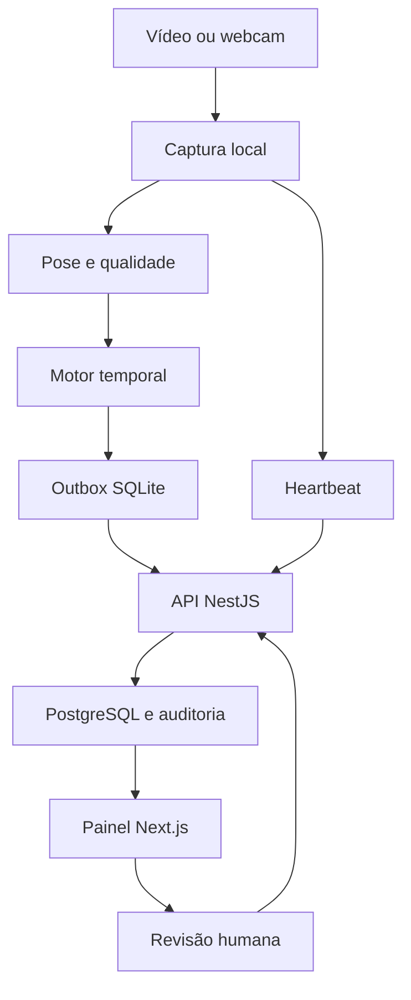

# Radar de Acontecimentos

**Base de construção do MVP v0.1 · Felipe Maia · 21/10/2026**

Um software de percepção assistiva que analisa vídeo no computador local, identifica uma **possível pessoa no chão / possível queda**, cria um incidente e permite que uma pessoa revise e registre a resposta.

O resultado pretendido é uma demonstração real, reproduzível e apresentável. Primeiro construiremos com dados simulados e vídeos autorizados; depois validaremos com a webcam do notebook. A câmera IP KAP-S069 entra se o equipamento permitir acesso compatível ao vídeo.

> **Estado atual:** etapas 00–08 concluídas **no escopo revisado da demonstração experimental de bancada** (D50/D51). Engenharia, instalação/restore isolados, FILE/LIVE→incidente→revisão e replay/API/painel offline verificados. Sessão LIVE nominal de 10 min: 600,660 s totais, 576,986 s elegíveis, 2799 análises, encerramento automático confirmado e zero eventos. Houve trecho no chão <10 s sem alerta: possível perda/inconclusivo, sem tempo exato/ROI confirmados. CAUCAFall: três de quatro alvos detectados, uma perda e zero alertas nos oito ADL, com cobertura limitada. Não aprova eficácia geral, piloto assistencial ou estabilidade prolongada; o teste original de 30 min não foi comprovado e a falha aos 27min45s permanece. Apresentação formal dispensada D50. Veja a [sessão física](docs/RELATORIOS/SESSAO_WEBCAM_10MIN_ETAPA_08.md), a [matriz final](docs/RELATORIOS/VALIDACAO_MVP.md) e o [relatório 08](docs/RELATORIOS/ETAPA_08.md). Aceite documental/manual: o checker ainda imprime gates originais fixos e não certifica esse aceite. Etapa 09 opcional, não iniciada. Snapshot real/purga pessoal desabilitados; dados e volumes preservados. Versionamento por commit/push solicitado pelo fundador; sem deploy.

Investigação de fluidez em 20 clipes: candidatos de acompanhamento visual deram
mais quadros intermediários em replay, mas ainda perderam segmentos e não foram
ativados no worker. A comparação não comprova maior precisão da pose nem FPS
ao vivo. [Métodos, testes e resultado](docs/RELATORIOS/FLUIDEZ_E_ALINHAMENTO_ETAPA_08.md).

Verificações e operação reproduzíveis:

Investigação quadro a quadro: fundador confirmou melhor acompanhamento na
cadeira; ainda há tremor. Comparados custo de CPU e modelo menor, com perdas
preservadas. Estabilização visual é opção da prévia, desligada por padrão, sem
alterar alertas ou comprovar fluidez LIVE. Medição real em arquivo atingiu cerca
de 5–7 desenhos/s no ensaio, sem 30 FPS. [Integração e reprodução](docs/RELATORIOS/EXECUCAO_REAL_E_PREVIA_ETAPA_08.md).

Complemento de 23/10: RTMO-s integrado como opção **experimental**, com score
articular explícito, sem trocar Full/Lite nas configurações existentes. Comparação
com motor e SQLite em 20 clipes: 8/12 eventos Full/RTMO, três perdas preservadas;
não é avaliação independente ou aprovação de eficácia. A melhora visual da cadeira
foi mantida no adaptador. [Integração, resultados e limites](docs/RELATORIOS/INTEGRACAO_RTMO_ETAPA_08.md).

Complemento da 08: recebidos 21 vídeos curtos do GMDCSA24 e dois de yoga, com
procedência e hashes conferidos. Foram processados com Full, mantendo modelo e
gates. Há detecções e perdas: nenhum aumento de precisão foi comprovado. A análise
dos dois longos soma cerca de 56 minutos de conteúdo em replay, não webcam contínua.
Veja [materiais, associação de arquivos e resultados](docs/RELATORIOS/MATERIAIS_ETAPA_08.md).
Os novos 05.mp4 e 07.mp4 substituíram arquivos antigos; as cópias históricas foram
recuperadas por SHA em caminhos separados. Não executar as configurações antigas
nesses novos arquivos apenas porque o nome coincide.

```powershell
. ./scripts/activate.ps1
pnpm.cmd demo:verify
pnpm.cmd demo:check --engineering
pnpm.cmd demo:check
```

O último comando ainda retorna 2 por uma lista manual fixa do plano original;
não lê o aceite documental D50/D51 nem certifica a percepção. O modo
--engineering verifica a engenharia da fonte atual. [Operação e backup](docs/OPERACAO_E_BACKUP.md) e
[apresentação de 5–7 minutos](docs/ROTEIRO_APRESENTACAO.md) descrevem comandos,
efeitos e limitações. Nenhum parceiro, serviço pago ou câmera IP é necessário.

Para iniciar, ative `. ./scripts/activate.ps1` em cada terminal e execute
`pnpm.cmd dev:api` e `pnpm.cmd dev:web` separadamente. Abra
`http://127.0.0.1:3000` e use seu proprietário existente. O roteiro explica a
câmera lógica exclusiva, a credencial exibida uma vez e o arquivo privado
`.local/demo.json`. `pnpm.cmd test:e2e` verifica o fluxo em PostgreSQL/API/web
exclusivos; instale o navegador uma vez com `pnpm.cmd test:e2e:install`.

A etapa 04 tem pipeline Python FILE, modelo Lite real, calibração de piso, prévia
local e medidas. Um vídeo autorizado foi processado integralmente em três
velocidades, com 89 observações por execução. O fundador marcou o piso e confirmou
o alinhamento da pose na prévia. Veja o [roteiro 04](docs/VALIDACAO_MANUAL_ETAPA_04.md) e o
[relatório 04](docs/RELATORIOS/ETAPA_04.md). Não cria incidentes nem classifica queda.

A etapa 05 acrescenta motor temporal, SQLite com retomada, entrega idempotente e
avaliação por episódios, habilitados explicitamente em configuração privada.
Está **concluída no escopo da bancada**: o Full produziu PERSON_ON_FLOOR em
`piso-f-07`, aos 6000 ms, com os mesmos gates de qualidade e persistência. A API
confirmou um incidente REPLAY/TEST; o fundador conferiu a prévia melhorada e os
sinais/versões/pose no painel. Retomada e reenvio não duplicaram esse incidente.
Lite continua disponível e é o padrão das configurações anteriores.
Os seis ensaios negativos iniciais com Lite e as falhas restantes com Full foram
preservados: não há detecção garantida para qualquer enquadramento ou estimativa
de eficácia independente. Veja o [roteiro 05](docs/VALIDACAO_MANUAL_ETAPA_05.md) e o
[relatório 05](docs/RELATORIOS/ETAPA_05.md). Não há captura ao vivo nesta etapa.

Um vídeo adicional confirmado como gerado por IA produziu um evento local por
análise de poses, identificado como material sintético, sem entrega HTTP. Essa
evidência de processamento não conclui a prova em filmagem real da etapa 05.

## 1. A decisão de partida

Vamos construir antes de procurar parceiros. Não é necessário ter investidor, sócio, cliente, equipe de instalação ou câmera própria para iniciar esta bancada. Esta decisão substitui a ordem “conseguir parceiro antes de programar” do dossiê de 20/10/2026.

A empresa poderá ser do fundador, e a primeira entrega será software. A câmera fornece as imagens; um computador com o worker executa a análise. Usar câmeras existentes não significa que qualquer câmera seja compatível, nem que a IA rode dentro delas. No MVP, o notebook permanece ligado durante a demonstração.

O nome “Radar” é provisório: **nesta versão o sensor é uma câmera, não um radar físico**.

## 2. Para que serve

Demonstrar uma cadeia completa: observar uma situação delimitada, apresentar uma suspeita com sinais verificáveis, avisar no painel e registrar o que o operador fez. O potencial futuro está em conectar percepção ambiental a uma resposta organizada, com integração a equipamentos existentes.

Exemplo: o sistema observa uma postura compatível com pessoa no chão por uma janela temporal. O painel mostra “Possível pessoa no chão”, câmera, horário, sinais utilizados e um desenho da pose. O operador reconhece, avalia e encerra ou descarta o incidente. Se a câmera falhar, o painel mostra a indisponibilidade separadamente.

**O protótipo não garante assistência ou detecção de toda queda.** Ele não diagnostica, identifica criminosos, reconhece rostos ou determina intenções. Um alerta gerado não significa ajuda prestada.

## 3. O que será entregue

| Capacidade obrigatória | Resultado esperado |
| --- | --- |
| Execução local | PostgreSQL em Docker; web, API e worker no computador do desenvolvedor |
| Acesso | Login local, permissões de proprietário e operador, credencial do worker |
| Fontes | Simulador de eventos, arquivo de vídeo e webcam; uma fonte ativa por execução |
| Caso de uso | Pessoa no chão; rótulo “possível queda” somente quando há trajetória compatível observada |
| Configuração | Uma área de piso, calibração e parâmetros versionados |
| Motor temporal | Analisa sequências e evita vários incidentes para o mesmo episódio |
| Incidentes | Lista, detalhe, reconhecimento, atendimento registrado, encerramento e descarte |
| Explicação | Sinais, modo da fonte, versão do modelo e da política, horários e pose do evento |
| Saúde da captura | Heartbeat, offline, pausa, fim de arquivo e degradações detectáveis |
| Persistência | Outbox SQLite no worker, ingestão idempotente e histórico PostgreSQL |
| Demonstração de aviso | Caixa de avisos no painel e canal simulado, sem enviar mensagens externas |
| Privacidade | Sem upload contínuo; snapshot opcional e desligado por padrão |
| Avaliação | Replay, testes de fluxo/falhas, benchmark e relatório de limitações |

Uma pessoa visível por vez, uma câmera fixa, iluminação suficiente e piso visível são **condições do escopo**. Detectar duas poses interrompe a classificação; detectar apenas uma não prova que não há outra pessoa oculta.

## 4. O que fica para depois

RTSP/KAP-S069 é uma extensão opcional da bancada. Câmera própria, radar mmWave, múltiplas câmeras simultâneas, identificação facial, áudio e voz, React Native, cobrança, WhatsApp/SMS reais, central 24h, nuvem, vigilância de ruas, previsão de agressões e classificação de pessoas estão fora da v0.1.

Não implementaremos treinamento de modelo grande, LLM por frame, Kubernetes, Kafka, microsserviços ou marketplace de sensores. Redis/BullMQ e AWS poderão entrar quando uma necessidade medida justificar. O produto executável não dependerá do ChatGPT ou de uma API paga de IA.

## 5. Stack escolhida

| Parte | Escolha | Motivo |
| --- | --- | --- |
| Web | Next.js 16, React, TypeScript, Tailwind CSS | Repertório do fundador e interface responsiva |
| API | NestJS 11, TypeScript, REST | Monólito modular e regras de negócio explícitas |
| Dados | PostgreSQL 17 + Prisma ORM 7 + driver `pg` | Persistência, migrações e transações |
| Visão | Python 3.12, MediaPipe Tasks Pose Landmarker Lite, OpenCV | Baseline local de pose, começando em CPU |
| Worker | CLI Python + Pydantic + HTTPX + SQLite | Captura, regras, envio e recuperação sem servidor extra |
| Ferramentas | Node.js 24 LTS, pnpm 10, uv, Docker Compose | Ambientes reproduzíveis |
| Testes | Jest/Supertest, pytest, Playwright | Fluxos, contratos, regras temporais e falhas |

As famílias de versões estão escolhidas. A etapa 00 fixará patches estáveis compatíveis e lockfiles após verificar o ambiente. **Não usar tags `latest`, prévias ou trocar majors silenciosamente.** O modelo de pose não é um classificador de quedas pronto. Ver [arquitetura](docs/02_ARQUITETURA_E_STACK.md) e [fontes/licenças](docs/10_FONTES_E_LICENCAS.md).

## 6. Como funciona



Frames ficam na memória do worker. Metadados de incidentes e uma pose de evidência são enviados à API. Snapshot JPEG exige habilitação explícita. Perder conexão com a API mantém a fila local, mas impede a atualização imediata do painel. Eventos atrasados reaparecem identificados como atrasados, sem aviso urgente novo.

## 7. Onde está cada definição

| Documento | Pergunta que resolve |
| --- | --- |
| [Produto e escopo](docs/01_PRODUTO_E_ESCOPO.md) | O que estamos construindo e o que caracteriza a v0.1? |
| [Arquitetura e stack](docs/02_ARQUITETURA_E_STACK.md) | Como dividir o código e executar cada componente? |
| [Contratos e dados](docs/03_CONTRATOS_E_DADOS.md) | Quais entidades, endpoints, eventos e estados usar? |
| [Motor de eventos](docs/04_MOTOR_DE_EVENTOS.md) | Como transformar poses em suspeitas temporais? |
| [Câmeras e calibração](docs/05_CAMERAS_E_CALIBRACAO.md) | Como usar notebook, celular e KAP-S069? |
| [Segurança e dados](docs/06_SEGURANCA_E_DADOS.md) | Como tratar credenciais, imagens, retenção e acesso? |
| [Validação e demonstração](docs/07_VALIDACAO_E_DEMO.md) | Como provar o que funciona e documentar o que falha? |
| [Ambiente e comandos](docs/08_AMBIENTE_E_COMANDOS.md) | O que instalar e quais comandos construir? |
| [Decisões e futuro](docs/09_DECISOES_E_FUTURO.md) | O que mudou do dossiê e o que vem depois? |
| [Fontes e licenças](docs/10_FONTES_E_LICENCAS.md) | De onde vêm as decisões técnicas e o que verificar? |
| [Status](docs/STATUS.md) | Qual etapa terminou e o que continua pendente? |
| [Instruções para a IA](AGENTS.md) | Como a IA deve trabalhar sem ampliar o escopo? |

## 8. Etapas de implementação

Cada etapa tem um README próprio, atividades, dependências, critérios de conclusão e **um prompt completo para copiar no ChatGPT do VS Code**.

| Etapa | Entrega | Depende de |
| --- | --- | --- |
| [00 — Fundação](etapas/00_FUNDACAO/README.md) | Monorepo, ferramentas, processos mínimos e diagnóstico do ambiente | Documentação |
| [01 — Domínio e acesso](etapas/01_DOMINIO_E_ACESSO/README.md) | Banco, login, local, câmera e credencial do worker | 00 |
| [02 — Eventos e incidentes](etapas/02_EVENTOS_E_INCIDENTES/README.md) | Contratos, ingestão, idempotência e fluxo de revisão | 01 |
| [03 — Painel e simulador](etapas/03_PAINEL_E_SIMULADOR/README.md) | Primeira demonstração completa com eventos simulados | 02 |
| [04 — Visão em vídeo](etapas/04_VISAO_EM_VIDEO/README.md) | Arquivo → poses, calibração, métricas e replay | 03 |
| [05 — Motor temporal](etapas/05_MOTOR_TEMPORAL/README.md) | Poses → episódios → incidentes reais de processamento | 04 |
| [06 — Webcam e resiliência](etapas/06_WEBCAM_E_RESILIENCIA/README.md) | Webcam, heartbeat, fila offline e recuperação | 05 |
| [07 — Evidência e proteção](etapas/07_EVIDENCIA_E_PROTECAO/README.md) | Snapshot opcional, retenção, auditoria e revisão de acesso | 06 |
| [08 — Validação e entrega](etapas/08_VALIDACAO_E_ENTREGA/README.md) | Demo reproduzível, benchmark e release local v0.1 | 07 |
| [09 — Câmera IP opcional](etapas/09_CAMERA_IP_OPCIONAL/README.md) | Testar RTSP e a KAP-S069, se compatível | 06; não bloqueia 08 |

Não há prazo prometido. Ao concluir 03 haverá uma demonstração de fluxo; ao concluir 05 haverá detecção exploratória em arquivos; ao concluir 08 haverá o MVP de bancada com uma fonte ao vivo validada.

## 9. Como usar este pacote no VS Code

1. Extraia a pasta `Radar_MVP` e abra essa pasta no VS Code. Os documentos podem ser a base de um novo repositório privado. Se já houver código, preserve-o e peça à IA que faça um inventário antes de adaptar.
2. Abra [etapa 00](etapas/00_FUNDACAO/README.md) e copie a seção **Prompt para o ChatGPT do VS Code**.
3. Deixe a IA executar somente essa etapa. Ela deve ler os documentos indicados, implementar, verificar e relatar resultados.
4. Revise a entrega e o relatório em `docs/RELATORIOS/`. Se houver falha, use o prompt de correção em [etapas/README.md](etapas/README.md).
5. Avance para o prompt da etapa seguinte depois de satisfazer o critério de conclusão. Uma nova conversa deve reler `AGENTS.md`, `README.md`, `docs/STATUS.md` e o README da etapa.

Você também poderá voltar a esta conversa com o relatório da etapa para receber o próximo prompt ajustado ao estado real do código. Os prompts deste pacote já permitem começar.

## 10. Quando o MVP estará pronto

Somente quando a etapa 08 demonstrar o fluxo completo com webcam ou outra fonte ao vivo efetivamente verificada, testes de falhas, ausência de duplicação, revisão auditável, reinício sem perda dos eventos pendentes e relatório com limites da detecção. A indisponibilidade da KAP-S069 não impede concluir usando a webcam.

Uma simulação de evento demonstra o software; um replay demonstra a análise daquele arquivo; um teste ao vivo demonstra as condições daquele ambiente. Nenhum deles, isoladamente, comprova desempenho em residências desconhecidas ou uso assistencial comercial. Esse próximo passo tem critérios próprios em [decisões e futuro](docs/09_DECISOES_E_FUTURO.md).
