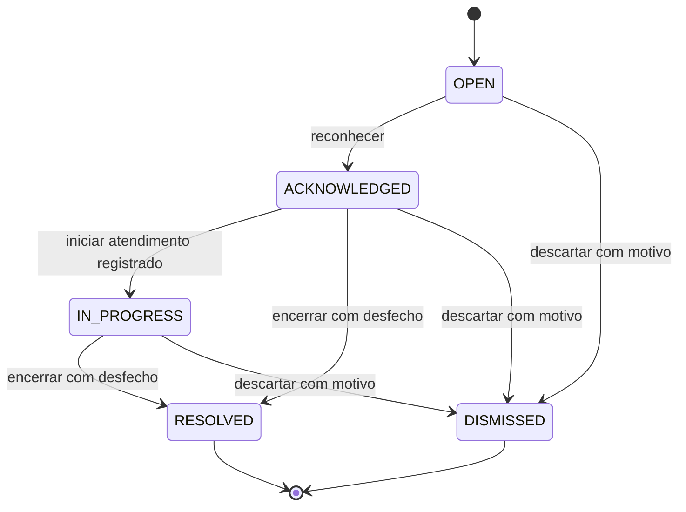

# Contratos, dados e estados

[Voltar ao README central](../README.md)

Este é o contrato normativo da v0.1. A etapa 02 materializou os JSON Schemas, tipos gerados e exemplos compartilhados em [packages/contracts](../packages/contracts/). Exemplos deste documento são fictícios; não representam eventos observados. [Roteiro HTTP/PowerShell](VALIDACAO_MANUAL_ETAPA_02.md) e [relatório 02](RELATORIOS/ETAPA_02.md).

## Vocabulário

| Termo | Significado |
| --- | --- |
| Observation | Resultado local de um frame: pose, qualidade e relógio monotônico; não enviado continuamente |
| Episode | Intervalo de uma mesma situação detectada; pode atravessar reenvio/reinício |
| Event | Mensagem imutável emitida uma vez para o episódio e reenviada com o mesmo ID |
| Incident | Registro de trabalho humano criado a partir do evento; tem estado e revisão |
| Notification | Aviso interno relacionado ao incidente; não comprova leitura ou atendimento |
| Evidence | Sinais e pose; snapshot é uma evidência adicional opcional |
| Device | Identidade estável do worker autorizada para uma câmera; permanece a mesma na rotação de token |
| Camera | Fonte lógica cadastrada no sistema; não guarda a senha ou URI privada de captura |

IDs UUID; horários UTC ISO 8601; durações e offsets em milissegundos. UI converte para o fuso do operador e informa o fuso no detalhe. Banco usa timestamps com timezone. Distâncias normalizadas são adimensionais, não metros clínicos ou físicos medidos.

Cada câmera possui um Device estável. Emitir ou rotacionar credenciais cria/revoga DeviceCredential, sem trocar deviceId nem reiniciar a deduplicação. Credencial de worker não é o login da câmera IP.

## Evento de ingestão

Endpoint `POST /v1/edge/events`, com `Authorization: Bearer <deviceToken>`. Corpo máximo 64 KiB. `tenantId`, usuário e permissão são derivados da credencial; não são aceitos como autoridade do payload. O `cameraId` deve corresponder à câmera da credencial.

```json
{
  "schemaVersion": 1,
  "eventType": "INCIDENT_CANDIDATE",
  "eventId": "d7cf7dc4-f837-4406-98a3-49b717e84e19",
  "episodeId": "9d12dd18-0a3e-4db2-873b-1ea754ccece3",
  "cameraId": "6ae2902d-e7d1-401a-8c39-45cd3043a986",
  "runId": "e80bf637-75cc-4982-aef2-88c05fe3125b",
  "mode": "SIMULATED",
  "kind": "PERSON_ON_FLOOR",
  "occurredAt": "2026-10-21T12:00:00.000Z",
  "detectedAt": "2026-10-21T12:00:02.000Z",
  "sourceOffsetMs": null,
  "signals": {
    "floorDurationMs": 2000,
    "torsoAngleDeg": 75,
    "bboxAspectRatio": 0.7,
    "hipInFloorZone": true,
    "rapidDescentObserved": false,
    "validPoseFraction": 1,
    "analysisFps": 5
  },
  "pose": [],
  "versions": {
    "worker": "simulator-v1",
    "model": "none-simulator",
    "policy": "floor-v0.1",
    "calibration": "synthetic-v1"
  }
}
```

`pose` pode ser vazio, inclusive quando a retenção visual foi desabilitada. A variante original é uma lista limitada de `{index, x, y, visibility}` com índices corporais 11 a 32 do MediaPipe; não enviar pontos faciais, `worldLandmarks` ou imagem no JSON. `x/y` devem ser finitos; podem sair ligeiramente de 0–1 por extrapolação do modelo. O motor não considera válido um ponto essencial fora do enquadramento. O desenho recorta no viewport; não alterar a medição antes da classificação.

Extensão experimental de 23/10/2026 (D47): o modelo
`rtmo-s-body7-640x640-20231211-onnx-v1`, com política `floor-rtmo-score-*`,
usa `{index, x, y, confidence}`. O score nativo não é visibility/presence.
São permitidos somente doze pontos anatômicos correspondentes a ombros,
cotovelos, punhos, quadris, joelhos e tornozelos: índices comuns 11–16 e 23–28.
Não misturar confidence e visibility, nem atribuir confidence a outro modelo.
Schema e validadores dos dois runtimes impõem essa distinção; a interface
identifica o score experimental. Não há inferência de necessidade de ajuda
ou visibilidade física a partir dele. A extensão do envelope v1 preserva os
envelopes antigos no conjunto local atualizado; leitores antigos não aceitam
a nova variante. Atualizar todos os componentes juntos, sem publicar API.

`occurredAt` é o início estimado da sequência candidata e `detectedAt` é a emissão. No modo ao vivo, derivar do relógio monotônico ancorado a UTC no começo da execução. No replay, usar relógio virtual ancorado ao começo da execução e armazenar `sourceOffsetMs`; esses horários não representam a data original de gravação. Replay nunca gera aviso urgente, mesmo que o relógio virtual esteja à frente do recebimento.

O motor usa tempo monotônico/timestamps de mídia para duração. Horário civil não controla os limiares. `receivedAt`, `incidentId`, `deliveryClass` e `tenantId` são definidos pela API. Nunca sobrescrever o horário original com o da sincronização.

Valores aceitos: `mode = SIMULATED | REPLAY | LIVE`; `kind = PERSON_ON_FLOOR | POSSIBLE_FALL`. A segunda descrição exige trajetória observada conforme o motor; não é uma confirmação de acidente.

## Validação e idempotência

Schemas `event-v1`, `heartbeat-v1` e `incident-action-v1` em `packages/contracts/src/schemas` usam JSON Schema draft-07, enums fechados e `additionalProperties: false` em todos os objetos. Ajv valida TypeScript e a API; Python usa jsonschema. `packages/contracts/fixtures/cases.json` é a mesma fonte de exemplos nos três caminhos. Tipos TypeScript são gerados por `pnpm.cmd contracts:generate`; a verificação detecta tipos desatualizados. Os tipos estáticos não substituem a validação de limites/condições em runtime.

Limites concretizados na etapa 02:

| Campo | Regra |
| --- | --- |
| UUID | Forma hexadecimal canônica de 36 caracteres; maiúsculas/minúsculas aceitas |
| Timestamps | UTC `YYYY-MM-DDTHH:mm:ss[.SSS]Z`, fração opcional de 1–3 dígitos; calendário real, ano 0000 e leap second rejeitados; armazenamento com precisão de milissegundos |
| Durações, offsets, sequence e contadores | Inteiros de 0 a 9.007.199.254.740.991; sem conversão de string/bool |
| `sourceOffsetMs` | Inteiro obrigatório em REPLAY; null em LIVE/SIMULATED |
| `torsoAngleDeg`, `bboxAspectRatio` | 0–180 graus; razão maior que zero e até 1.000 |
| `analysisFps`, frações, visibility | FPS de 0–1.000; fração/visibility de 0–1 |
| Pose | Máximo 22 índices únicos, 11–32; x/y finitos, sem clamp a 0–1; unicidade de índices também validada após o schema em ambas as linguagens |
| `versions.*` | 1–120 caracteres ASCII; início alfanumérico, seguido de alfanumérico, ponto, sublinhado, `+` ou `-` |
| Heartbeat | Flags únicas, no máximo as oito documentadas; `lastFrameAgeMs` pode ser null durante aquecimento |
| Ações | `expectedVersion` inteiro de 1–2.147.483.647; nota não vazia/não composta apenas por espaços, até 2.000 caracteres |

O teto de 64 KiB é aplicado ao corpo HTTP antes da validação. JSON malformado retorna 400, corpo excedente 413, payload fora do schema 422 `INVALID_PAYLOAD`. Credencial ausente/revogada retorna 401; câmera fora do bearer retorna 403 `CAMERA_SCOPE_MISMATCH`, inclusive outra câmera do mesmo tenant. Não há autoridade concedida por campos enviados no payload.

- Unicidade de recibo por `(deviceId, eventId)`.
- Unicidade de incidente por `(cameraId, episodeId)` dentro do tenant.
- Novo evento: transação persiste recibo, incidente `OPEN`, auditoria e intenção de aviso; responde 201 somente após commit.
- Reenvio idêntico: 200 com o mesmo `incidentId` e `duplicate: true`.
- Mesmo `eventId` com conteúdo diferente: 409, `EVENT_ID_CONFLICT`; não alterar o original. Comparar representação canônica, não ordem de chaves JSON.
- Mesmo episódio com novo event ID e contexto imutável equivalente: registrar recibo deduplicado e apontar ao incidente existente. Divergência de câmera, modo ou conteúdo exige 409 `EPISODE_CONFLICT`.
- Resposta de sucesso contém `eventId`, `incidentId`, `receivedAt`, `duplicate`, `deliveryClass`.
- Falha antes do commit: 5xx; cliente reenvia o mesmo evento. Timeout depois de commit também se resolve pela idempotência.

Na etapa 02, o hash SHA-256 usa JSON com chaves de objetos ordenadas recursivamente, arrays na ordem original e números representados como JSON pelo runtime Node. Não é uma implementação declarada de RFC 8785. O hash de episódio inclui todos os campos do envelope exceto `eventId`: `runId`, horários, modo, sinais, pose e versões continuam imutáveis. Um novo run não reescreve um evento anterior; reenvie seu envelope original. O escopo da unicidade de episódio é a câmera, não um UUID global entre câmeras. Uma tentativa fora do escopo da credencial é rejeitada antes da comparação de episódio.

O bloqueio de linha da câmera serializa ingestões/heartbeat; restrições únicas e FKs compostas no PostgreSQL continuam protegendo as chaves e o tenant. Para recibo conhecido, a deduplicação precede os limites de idade de um novo envelope. O retorno usa a classe e o recebimento daquele recibo; o novo recibo de episódio equivalente recebe seu próprio `receivedAt`, mantendo incidente e classe originais.

Validação 400/422 e conflito 409 de evento não entram em retry infinito: mover item para erro permanente local, mostrar motivo sem dados sensíveis. 401/403 suspende envio e exige corrigir/revogar credencial. 408/429/5xx e erro de rede usam backoff. Persistir evento antes de qualquer HTTP. RUN_CONFLICT do heartbeat tem tratamento próprio: aguardar a execução anterior terminar/expirar, sem descartar eventos pendentes.

O payload detalhado pode sofrer redação por retenção, mantendo hash e chaves técnicas. Conservar recibos mínimos de deduplicação por 90 dias; após purga do incidente, reenvio da chave responde 410 EVENT_EXPIRED, sem recriar o incidente. Novos envelopes com detectedAt há mais de 30 dias, ou mais de 24 h no futuro, são rejeitados como 410 EVENT_TOO_OLD / 422 INVALID_EVENT_TIME antes da criação. Isso limita a janela de reenvio e impede ressuscitar dados purgados. No worker, 410 vira erro permanente visível, nunca exclusão silenciosa. Testes usam relógio controlado e atualizam os timestamps dos exemplos.

## Atualidade e avisos

| `deliveryClass` | Regra inicial | Comportamento |
| --- | --- | --- |
| `TEST` | `SIMULATED` ou `REPLAY` | Caixa de demonstração; nenhum aviso urgente |
| `CLOCK_UNCERTAIN` | LIVE com `detectedAt` > recebimento + 30 s, ou horários incoerentes | Exibir problema de relógio; sem urgência automática |
| `DELAYED` | LIVE recebido mais de 120 s após `detectedAt` | Histórico e fila de revisão, destacado como atrasado |
| `CURRENT` | LIVE dentro da janela, relógio coerente | Aviso novo no painel; canal ainda é simulado |

Essas janelas são configurações de bancada, não políticas de atendimento clínico. Ao perder um ACK e reenviar, preservar a classificação e os avisos originais. Não criar uma nova urgência. Snapshot recebido depois não muda a classificação.

## Estados de incidente



Estados finais não reabrem na v0.1. Não apagar registro para corrigir interpretação; adicionar nota auditada. Status do worker não encerra nem reconhece incidente.

Toda ação exige `actionId` UUID, `expectedVersion` inteiro, `action` válida e ator autenticado. `RECOGNIZE`, `START_RESPONSE`, `SET_REVIEW`, `RESOLVE`, `DISMISS`, `ADD_NOTE` são ações do contrato. Reenvio do mesmo `actionId` e conteúdo devolve o resultado anterior; conteúdo diferente dá conflito. Versão desatualizada dá 409; a UI recarrega antes de oferecer nova ação.

`RESOLVE` exige um `outcome`: `ASSISTANCE_RECORDED`, `NO_ASSISTANCE_NEEDED`, `INCONCLUSIVE` ou `TEST_COMPLETED`, além de `review` diferente de UNREVIEWED. `DISMISS` exige `reason`: `FALSE_DETECTION`, `TEST_EVENT`, `DUPLICATE` ou `OTHER`, com `note` obrigatória para OTHER. FALSE_DETECTION grava review FALSE_POSITIVE; os outros descartes preservam revisão existente ou INCONCLUSIVE quando ainda não revista. O rótulo da tela é “atendimento registrado”, não “socorro garantido”.

`SET_REVIEW` altera somente a revisão em estados não finais, com campo `review` e `note` opcional. `ADD_NOTE` exige `note` e é permitida inclusive em estados finais, sem reabri-los. Notas têm limite de 2.000 caracteres. Ações sem necessidade de determinado campo o rejeitam; schema deve usar variantes por ação. Todas incrementam a versão e registram auditoria, exceto reenvio idêntico que devolve o resultado original.

O `actionId` é único no tenant e seu hash inclui `incidentId` e todo o corpo. Reutilizá-lo com outro corpo/incidente retorna 409 `ACTION_ID_CONFLICT`. Um advisory lock transacional serializa a chave; um bloqueio do incidente permite conferir `expectedVersion` e registrar alteração/ação/auditoria atomicamente. A repetição é consultada antes da versão/transição atuais e devolve o snapshot original `{incidentId,actionId,status,review,outcome,dismissReason,version,updatedAt}`. Nova ação com versão antiga retorna 409 `VERSION_CONFLICT`; transição vedada retorna 409 `INVALID_TRANSITION`. `GET /audit?incidentId=...` inclui os campos da ação e suas versões, permitindo consultar notas; logs técnicos não incluem esse conteúdo.

Revisão separada do estado: `UNREVIEWED`, `PERSON_ON_FLOOR_CONFIRMED`, `FALL_REPORTED`, `FALSE_POSITIVE`, `INCONCLUSIVE`. `FALL_REPORTED` significa relato/revisão humana; não diagnóstico pelo modelo. Uma pessoa deitada voluntariamente pode confirmar a postura no chão e ser um falso alerta de necessidade de ajuda. Avaliar esses objetivos separadamente.

## Heartbeat e saúde

`POST /v1/edge/heartbeat` usa a mesma credencial. Enviar a cada 5 s enquanto o processo estiver ativo e imediatamente em mudanças. Campos: `schemaVersion`, `cameraId`, `runId`, `mode`, `sequence`, `sentAt`, `captureState`, `qualityFlags`, `analysisFps`, `outboxPending`, `lastFrameAgeMs`, `inferenceState` e `versions`.

- `captureState`: `RUNNING | PAUSED | ENDED | ERROR`.
- `inferenceState`: `WARMING_UP | NO_POSE | ONE_VALID_POSE | LOW_CONFIDENCE | MULTIPLE_POSES`.
- `qualityFlags`: lista fechada inicial `LOW_LIGHT`, `POSSIBLE_FROZEN`, `LOW_FPS`, `FRAME_TIMEOUT`, `CALIBRATION_REQUIRED`, `STORAGE_FULL`, `CAPTURE_ERROR`, `MODEL_ERROR`.
- Somente o heartbeat atual é enviado; não persistir uma fila histórica. Ignorar `sequence` antigo dentro do mesmo `runId`.
- Uma câmera tem uma execução ativa. O primeiro heartbeat anuncia `runId`; outro run ativo recebe 409 `RUN_CONFLICT` até encerramento explícito ou expiração de 15 s do anterior. Replay de eventos antigos pode ser aceito sem se tornar a execução ativa.

O servidor usa seu próprio horário de recebimento para avaliar heartbeat. UI mostra `PAUSED`/`SOURCE_ENDED` se o último heartbeat confirmou parada intencional; para execução esperada como ativa, ausência há mais de 15 s dá `OFFLINE`. Heartbeat fresco com flags dá `DEGRADED`; sem flags, `ONLINE`. Mostrar também há quanto tempo o status foi recebido; pausa persistida não comprova que o processo continua ligado.

`GET /cameras` e `GET /cameras/:id` incluem `health: {state,expectedRunning,receivedAt,ageMs,stale,heartbeat}`. Sem heartbeat o estado é OFFLINE, com `ageMs: null`; `expectedRunning` continua informando a expectativa cadastrada separadamente. ERROR fresco dá DEGRADED mesmo sem flag. O lease é válido até 15.000 ms inclusive; após isso, outro run pode assumir. Heartbeat aceito retorna 200 `{accepted:true,ignored:false,health}`. Sequência repetida/menor retorna 200 `{accepted:false,ignored:true,reason:OLD_SEQUENCE,health}` sem renovar o recebimento. Run substituído retorna `RETIRED_RUN`; ENDED não pode voltar a RUNNING com o mesmo runId (409 `RUN_CLOSED`). Outro run pode assumir imediatamente após ENDED.

`CameraRun` mantém apenas IDs e horários de primeira recepção/aposentadoria para impedir que pacotes de runs substituídos ressuscitem uma execução. Não é uma fila nem histórico de payloads de heartbeat: somente o último payload fica na Camera. A retenção dessas chaves técnicas será tratada com as demais rotinas na etapa 07. Eventos, inclusive históricos, nunca alteram esse lease.

“ONLINE” significa conexão/captura aparentemente disponíveis, não garantia de cobertura ou ausência de queda. `NO_POSE` não significa que não existe pessoa. Sinais de baixa luz/congelamento são heurísticas e podem errar.

## API mínima

Todos os caminhos abaixo têm prefixo `/v1`. Sessão de usuário e bearer de device são mecanismos separados.

| Método e caminho | Acesso | Uso |
| --- | --- | --- |
| `GET /health/live` | Local, sem sessão | Processo responde, sem detalhes sensíveis |
| `GET /health/ready` | Local, sem sessão | Dependências prontas; 503 se banco indisponível |
| `POST /auth/login`, `POST /auth/logout`, `GET /auth/me` | Login/sessão | Sessão local |
| `GET /sites`, `POST /sites` | Leitura autenticada; criação OWNER | Local de demonstração |
| `GET /sites/:id`, `PATCH /sites/:id` | Leitura autenticada; alteração OWNER | Detalhe/nome/timezone; 404 para registro de outro tenant |
| `GET /cameras`, `POST /cameras`, `PATCH /cameras/:id` | Leitura autenticada; alteração OWNER | Nome, local, tipo e expectativa de execução |
| `GET /cameras/:id` | Sessão | Detalhe no tenant autenticado |
| `POST /cameras/:id/device-credentials` | OWNER | Emite/rotaciona token uma vez |
| `GET /cameras/:id/device-credentials` | OWNER | Metadados paginados id/deviceId/version/createdAt/revokedAt; sem token/hash (03) |
| `DELETE /device-credentials/:id` | OWNER | Revoga token |
| `GET /edge/me` | Device | Diagnóstico do tenant/câmera/device da credencial; não ingere eventos |
| `POST /edge/events`, `POST /edge/heartbeat` | Device | Ingestão e saúde |
| `GET /incidents`, `GET /incidents/:id` | OWNER/OPERATOR | Lista filtrada e detalhe |
| `POST /incidents/:id/actions` | OWNER/OPERATOR | Transição/revisão/nota auditada |
| `GET /notifications` | Sessão | Caixa de avisos locais |
| `POST /edge/events/:eventId/snapshot` | Device correspondente | JPEG opcional de evento persistido |
| `GET /incidents/:id/snapshot` | Sessão autorizada | Imagem; 404 ausente, 410 expirada |
| `DELETE /incidents/:id/snapshot` | OWNER | Exclusão da imagem, com auditoria mínima |
| `GET /audit?incidentId=...` | Sessão autorizada | Histórico do incidente, sem segredos |

Listagens usam `limit` padrão 20/máximo 100 e cursor estável `(createdAt,id)`. Filtros de incidentes: status, câmera, modo e intervalo. Nenhum filtro pode mudar o tenant da identidade. API gera OpenAPI a partir da implementação; o schema de eventos compartilhado continua sendo a referência entre linguagens.

Na etapa 02 os filtros são `status`, `cameraId`, `mode`, `from` e `to`; intervalo inclusivo de `occurredAt`, com datas ISO 8601. Intervalo invertido retorna 400. Detalhe/lista retornam o incidente, sinais/pose/versões e campos humanos separados, sem o hash interno. Ações e auditoria usam endpoints próprios. Todas as listagens retornam `{items,nextCursor}`. Leituras e ações exigem sessão OWNER/OPERATOR; escrita humana exige Origin da web. Bearer continua reservado a `/edge/*`. Snapshot/Evidence ainda pertencem à etapa 07.

O executor local Nest consulta intenções PENDING a cada segundo e na inicialização. `FOR UPDATE SKIP LOCKED`, unicidade por intenção e uma transação para entrega/auditoria/status impedem duplicação mesmo com executores concorrentes. Falha reverte tudo e mantém a intenção elegível para nova tentativa; o polling atual não usa backoff exponencial. `attempts` contabiliza processamentos que chegaram a commit, não falhas de conexão. O aviso armazena `channel: SIMULATED`, modo e classe explícitos; `urgent` só é true para CURRENT. A intenção é criada por incidente; reenvios e ações não criam outro aviso. Não há serviço externo, confirmação de leitura nem promessa de assistência.

Definições concretizadas na etapa 01: `Camera.type = FILE | WEBCAM | RTSP` (alinhado ao `source.kind` do worker); `expectedRunning` booleano, inicialmente false, expressa somente expectativa, sem anunciar captura online. POST/PATCH não aceitam URI, senha de câmera ou `tenantId`. GET de câmera inclui apenas o ID do Device, sem hash ou credencial. Emissão/rotação retorna `{id, deviceId, cameraId, version, createdAt, token}` uma vez; não há leitura posterior do token. Todas as listagens da 01 retornam `{items,nextCursor}` e ordenam por `(createdAt,id)` ascendente. Sessões e detalhes são `Cache-Control: no-store`.

O login usa e-mail globalmente único normalizado em minúsculas (D17), sem tenant no payload. Credenciais humanas e de worker usam espaços de tokens distintos; bearer não substitui cookie humano. O OpenAPI inicial é servido em `/v1/openapi.json` e gerado em `docs/OPENAPI.json` por comando local.

## Modelo relacional mínimo

| Entidade | Campos e restrições centrais |
| --- | --- |
| Tenant | Identidade do ambiente; um tenant na demo |
| User | tenant, e-mail de login, passwordHash, role, ativo |
| Session | user, hash do token, expiração; logout revoga |
| Site | tenant, nome, timezone |
| Camera | tenant/site, nome, tipo, status/heartbeat mais recente; sem segredo RTSP |
| Device | tenant/camera, identificador estável; único por câmera na v0.1 |
| DeviceCredential | tenant/device, hash do token, versão, revogadaEm |
| EventReceipt | tenant/device, eventId, episodeId, hash canônico, payload redigível, recebimento, incidentId anulável após purga |
| Incident | tenant/site/camera, episódio, kind, mode, status, review, deliveryClass, versão, horários e desfecho |
| IncidentAction | incident, actionId, ator, ação, versão, payload mínimo; chave de idempotência |
| NotificationIntent | incident e chave única, status, próxima tentativa |
| NotificationDelivery | intent, canal SIMULATED, resultado, horário; idempotente |
| Evidence | incident, identificador opaco, hash, tipo, bytes, expiresAt, deletedAt |
| AuditEntry | tenant, ator, objeto, ação, resultado e horário |

Índices iniciais: incidentes `(tenantId, siteId, occurredAt, id)` e `(tenantId, status, createdAt, id)`; recibos e ações com unicidades descritas; intenções pendentes por status/próxima tentativa. Todas as relações conferem o mesmo tenant. Chaves compostas/restrições devem impedir relações entre tenants além das verificações da API. Na purga de incidente, preservar recibo mínimo com marcador expiredAt e relação anulada explicitamente; não cascatar a exclusão da chave de deduplicação antes do prazo.

O usuário não acessa SQLite do worker. A API não lê a URI privada de captura. Testes criam dois tenants artificiais para demonstrar isolamento, sem construir telas de gestão de múltiplos clientes.

Integração na etapa 03: o painel usa somente `/api/*` e cookies HttpOnly, com
consultas `no-store`. A listagem de metadados de credenciais permite revogar por ID
após recarga, mantendo leitura exclusiva de OWNER e escopo de câmera/tenant.
Não permite consultar novamente o segredo. Emissão/rotação continua sendo POST
explícito com confirmação na interface; polling nunca emite credenciais.

Ações do painel mantêm um actionId e corpo por intenção. Falha transitória permite
reenviar a mesma tentativa; 409 recarrega o estado e exige conferir/preparar outra
intenção. Polling não reescreve notas nem confirma transição automaticamente.
Rascunhos e tentativas ficam em memória: sobreviver à expiração com a mesma conta
não equivale a persistência offline, que continua fora desta etapa.


## Evidências implementadas na etapa 07

`event-v1` aceita `evidenceMode?: none | skeleton | snapshot`. Ausência preserva
legacy skeleton e não altera envelopes anteriores. none gera pose vazia; o
backend também aplica preferência none da câmera a incidente e recibos, mantendo
hash original para idempotência. Preferência snapshot exige autorização OWNER
registrada antes de receber o evento, além da escolha local do worker. Sem ela,
metadados são aceitos como skeleton e o JPEG permanece desabilitado.

`POST /edge/events/:eventId/snapshot` recebe bytes binários, no máximo 2 MiB,
JPEG decodificável, maior lado 1280, até 1.638.400 pixels. Retorna 201
`{eventId,incidentId,hash,duplicate}`; hash é SHA-256 original e duplicate=true no
reenvio idêntico. 409 para substituição/outra chave do mesmo episódio; 410 para
marcador excluído/expirado; 403 se desabilitado/sem autorização; 404 fora do device.
ACK de imagem é distinto do ACK do evento e não muda classe/horários/estado humano.

`GET /incidents/:id` inclui `evidenceMode`, `poseRedactedAt` e
`snapshot: {mode,state,expiresAt}`. Estado DISABLED, AWAITING, AVAILABLE, DELETED ou
EXPIRED; AWAITING significa ausente ou pendente, sem inventar saúde da fila remota.
`GET /incidents/:id/snapshot` autenticado/no-store retorna JPEG, 404 quando
não disponível, 410 removido/expirado e 503 para falha temporária de disco/leitura.
`DELETE` exige OWNER/Origin, é idempotente, audita e não altera versão/estado humano.
O painel não usa URL pública, otimizador de imagem ou armazenamento local durável.

Preferências: `PATCH /cameras/:id/evidence-preference {mode,authorized}` e
`GET/PATCH /retention-preference` (`{enabled}` na escrita), com OWNER/Origin em
mutações. Preferência none continua valendo para novos recibos do mesmo incidente
mesmo depois de outra escolha na câmera. Recibos redigidos mantêm payloadHash;
novas chaves equivalentes de episódio redigido não repõem pose. Após purga do
incidente, o recibo mínimo tem incidentId=null/expiredAt e responde EVENT_EXPIRED;
outra chave do episódio também não o recria durante os 90 dias retidos.

Prazos/ativação e cópias: [segurança](06_SEGURANCA_E_DADOS.md). Comandos e exemplos:
[roteiro 07](VALIDACAO_MANUAL_ETAPA_07.md).
